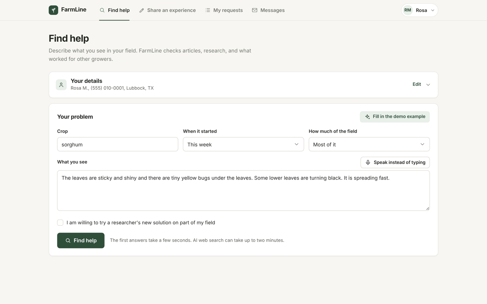
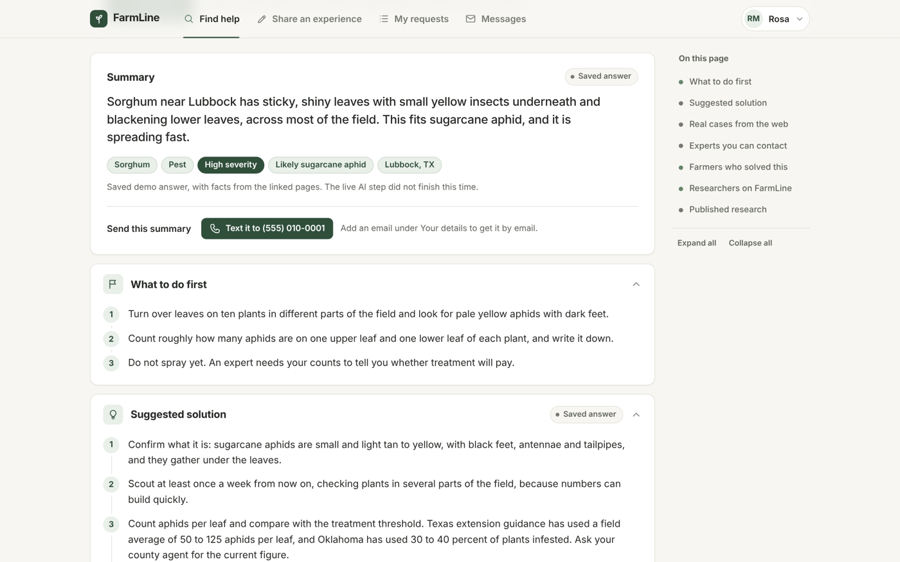
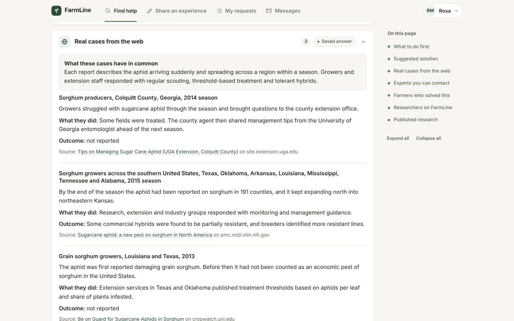
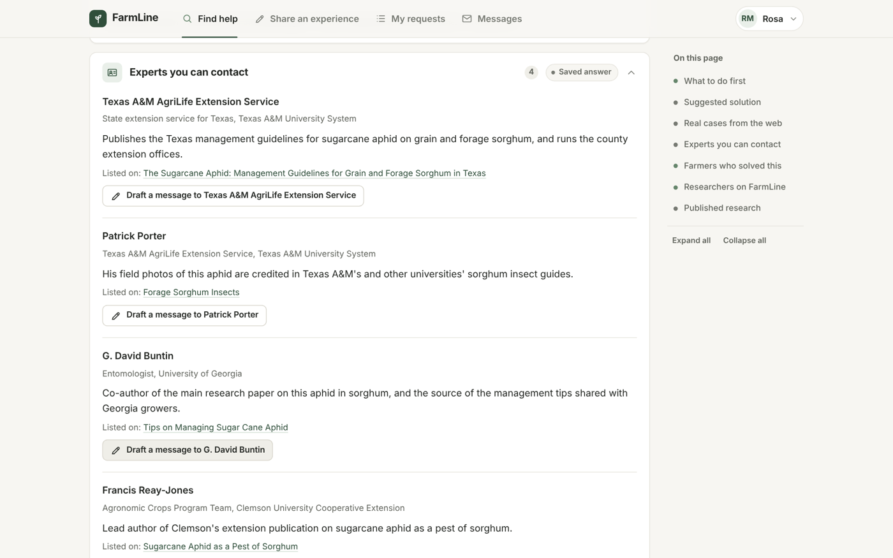
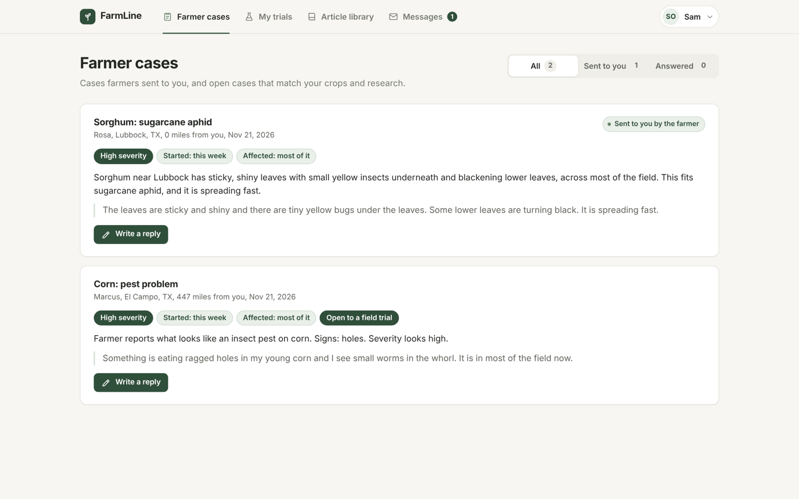
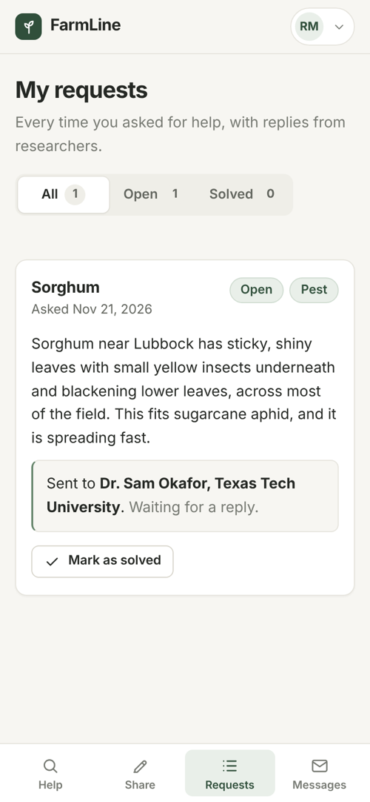

# FarmLine

**Crop problems, answered by people who have solved them.**

A farmer describes a sick crop once. FarmLine returns a plain summary, safe first steps, a solution written from real extension articles and research with every source linked, real cases other growers reported on the web, and the people who can help: farmers who solved it, extension experts nearby, and researchers who study it.




## Contents

- [Why](#why)
- [What it does](#what-it-does)
- [Quick start](#quick-start)
- [Turning on the real services](#turning-on-the-real-services)
- [Screenshots](#screenshots)
- [Where the answers come from](#where-the-answers-come-from)
- [The phone line](#the-phone-line)
- [How it is built](#how-it-is-built)
- [Filling the article library](#filling-the-article-library)
- [Checking what works](#checking-what-works)
- [What is real and what is demo](#what-is-real-and-what-is-demo)
- [Known gaps](#known-gaps)
- [License](#license)

## Why

Up to 40% of global crop production is lost to pests and diseases each year ([FAO, 2021](https://www.fao.org/newsroom/detail/Climate-change-fans-spread-of-pests-and-threatens-plants-and-crops-new-FAO-study/en)). Most of those problems are already understood. A farmer nearby has usually fixed the same thing, a researcher at a nearby university studies it, and an extension factsheet explains it. The farmer who needs the answer today cannot reach any of them in time, and in many places one extension officer serves thousands of farmers.

FarmLine is the missing connection.

## What it does

**Farmers**

- Describe a problem by typing or speaking, or by calling the phone line
- Get a plain summary, safe first steps, and a suggested solution with its sources
- See real cases other growers reported, with a link to each source
- Reach extension experts and researchers, with a message drafted for them
- Share what fixed their own problem, which becomes the answer for the next farmer

**Researchers**

- See cases farmers sent them, plus open cases that match their crops and topics
- Reply with advice, an offer to test a solution on that field, or a request for a sample
- List trials they want to run on real farms
- Add factsheets and papers to the library FarmLine reads

## Quick start

Needs Python 3.10 or newer. No API keys required to try it.

```bash
git clone https://github.com/YOUR-USERNAME/farmline.git
cd farmline
pip install -r requirements.txt
uvicorn app:app --reload
```

Open <http://localhost:8000>. On a phone, use "Add to Home Screen" to install it as an app.

Demo accounts, created on first run:

| Role | Sign in | Password |
|---|---|---|
| Farmer | phone `555 010 0001` | PIN `1234` |
| Researcher | `okafor@demo.farmline` | `demo1234` |

Other demo researchers: `rivera@`, `nguyen@`, `salinas@demo.farmline`. Or create your own accounts.

On the Find help screen, **Fill in the demo example** loads a prepared case (sugarcane aphid on sorghum near Lubbock) so you can see the whole flow in one click.

## Turning on the real services

Copy `.env.example` to `.env` and fill in what you have. Each key is independent; without it, that part runs in demo mode.

| Key | Turns on | Where to get it |
|---|---|---|
| `GEMINI_API_KEY` | The AI: summaries, solutions from articles and Google Search, expert lookup | [aistudio.google.com](https://aistudio.google.com) (free tier) |
| `ANTHROPIC_API_KEY` | The same AI features using Claude instead | [platform.claude.com](https://platform.claude.com) |
| `OPENALEX_API_KEY` | More paper searches per day, plus researchers at nearby universities | [openalex.org/settings/api](https://openalex.org/settings/api) (free) |
| `TWILIO_*` | Text messages and the phone line | [twilio.com](https://www.twilio.com) |
| `SMTP_*` | Email summaries | Your email provider |

Fill in **one** of the two AI keys. If both are set, Gemini is used unless you set `AI_PROVIDER=claude`.

> `.env` is in `.gitignore`. Never commit a real key.

## Screenshots

| The answer, with its sources | Real cases from the web |
|---|---|
|  |  |

| Experts you can contact | The researcher's side |
|---|---|
|  |  |

<p align="center"></p>

## Where the answers come from

Every request draws on six sources. The request system, where farmers and researchers answer each other directly, runs alongside them.

| Source | What it gives | Needs |
|---|---|---|
| Article library | Real pages and PDFs read from the web, plus imported datasets, searched by text similarity (TF-IDF) | Internet on first start |
| Research papers | Papers on the exact problem and the people who wrote them, from OpenAlex | Works without a key on a small daily allowance |
| AI | Reads the library passages and paper abstracts, searches the web, writes a solution with its sources | An AI key |
| Real cases from the web | Reported cases from forums, Reddit, extension field reports and news, each with its source link | An AI key whose web search works |
| Experts | Extension offices, agents, specialists and diagnostic labs near the farmer, from official pages | An AI key whose web search works |
| People | Farmers who solved it, researchers on FarmLine | Nothing |

Researchers who are not on FarmLine get a Contact button. It drafts an email about the case and, with an AI key, looks up their public university page and any email listed there. If they later sign up with that email, the case is waiting for them.

## The phone line

The phone line needs a number that can run code when it rings, which a personal mobile number cannot do.

1. Buy a Twilio number with voice and SMS.
2. Expose the app: `ngrok http 8000`.
3. In Twilio, set the number's voice webhook to `https://<ngrok-url>/voice` (POST).
4. Put the number in `.env` as `HELPLINE_NUMBER` and `TWILIO_FROM_NUMBER`.

A caller says the problem, hears first steps and a matched farmer's fix, presses 1 to share their number with that farmer or 2 to send the case to a researcher, then gets the summary by text. The call creates an account for that phone number, so a caller who later signs up with the same number finds their calls already there.

## How it is built

```
Web app  ─┐                                        ┌─ Gemini or Claude  (language, web search)
          ├─→  FastAPI server  ────────────────────┼─ OpenAlex          (papers and authors)
Phone line┘    · understand the description        ├─ Extension pages   (read into the library)
               · search the article library        └─ Twilio and SMTP   (texts and email)
               · match farmers and researchers
               · check sources before showing
                        │
                     SQLite
```

| File | Job |
|---|---|
| `app.py` | Accounts and sessions, farmer and researcher APIs, the phone line |
| `brain.py` | The AI: summaries, suggested solutions, real cases, expert and contact lookups |
| `matching.py` | Farmer experiences, FarmLine researchers, OpenAlex papers and people |
| `library.py` | Article library: reading pages, importing datasets, TF-IDF search |
| `geo.py` | Address to coordinates (OpenStreetMap, then a built-in town list) |
| `notify.py` | Text and email |
| `demo.py` | Demo safety net: live first, saved answer only if a step fails |
| `db.py` | SQLite tables and migrations |
| `check.py` | Tests each outside service and prints OK or FAIL with the reason |
| `config.py` | Region settings: towns, universities, crops |
| `static/index.html` | The whole front end: design tokens and components, then the screens |
| `seed_data.json` | Demo farmers, experiences, researchers and trials |
| `demo_case.json` | The one prepared demo case and its saved answers |
| `sources.txt` | Web addresses the library reads on first start |

Delete `farmline.db` to start fresh.

### Moving it to another region

Edit `config.py`: the towns, the universities, and the crops. Replace `seed_data.json` and `sources.txt` with material for your area, and set `CALL_LANGUAGE` in `.env` for the phone line's language.

## Filling the article library

On first start the app reads every address in `sources.txt` in the background. To add more:

```bash
python library.py add-urls sources.txt                      # after editing the file
python library.py add-url https://extension.example.edu/x   # one page or PDF
python library.py add-csv data.csv --question COLUMN --answer COLUMN --crop COLUMN
python library.py search "sorghum sticky leaves aphids"     # try a search
python library.py stats
```

`add-csv` imports question-and-answer datasets, such as farmer help-line logs. Researchers can also add pages from the Article library screen, and pages the AI's web search uses are added automatically.

The reader identifies itself, obeys each site's `robots.txt`, and stores text only on your own machine. Check a site's terms before reading it in bulk. It does not scrape Google results; web search goes through the AI's own search tool.

## Checking what works

```bash
python check.py
```

This tests the AI key, the AI's web search, the real-cases and experts searches, the research paper search, and web access, printing OK or FAIL with the reason for each. While the app runs, every AI call is logged in the terminal as a line starting with `[FarmLine AI]`.

## What is real and what is demo

- **Real:** research papers and their authors from OpenAlex; extension articles read from the web; AI answers and the sources shown beside them.
- **Demo:** the farmers, experiences and researchers that exist on first start. They are invented and labelled "(demo account)". Set `SEED_DEMO=0` in `.env` and delete `farmline.db` to start with none.
- **The demo safety net:** for the one prepared case in `demo_case.json`, every live step still runs first. If a step fails or takes longer than `DEMO_WAIT` seconds, its saved answer is shown and the screen says so. Saved answers are never presented as live AI. Set `DEMO_CASE=0` to turn it off.

## Known gaps

This was built at a hackathon. Before anyone relies on it:

- The AI solution can be wrong. It shows its sources and drops any link it was not actually given, but an expert should confirm before treatment.
- The AI is instructed never to give chemical doses or mixing rates; it points to the product label and the local extension office.
- A looked-up researcher email comes from an AI web search. Check it on the linked page before sending.
- Real cases are summarised by AI from public pages, so the summary can misread a thread. The source link is always shown, and usernames never are.
- Passwords are hashed, but there is no password reset, phone verification, or rate limiting.
- Twilio request signatures are not verified.
- The phone line is written but has not been tested on a live number.
- `sources.txt` covers only sorghum aphids and wheat stripe rust. Add addresses for your own crops.

## License

MIT. See [LICENSE](LICENSE).
